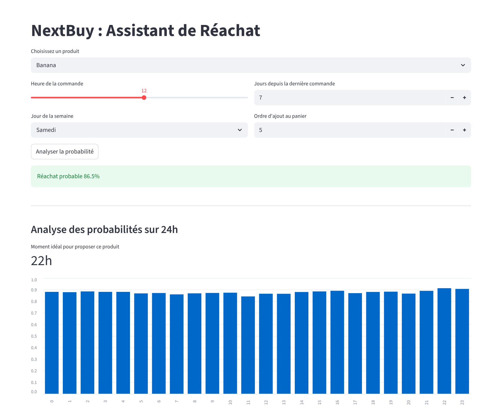
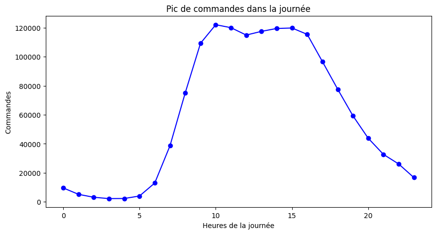
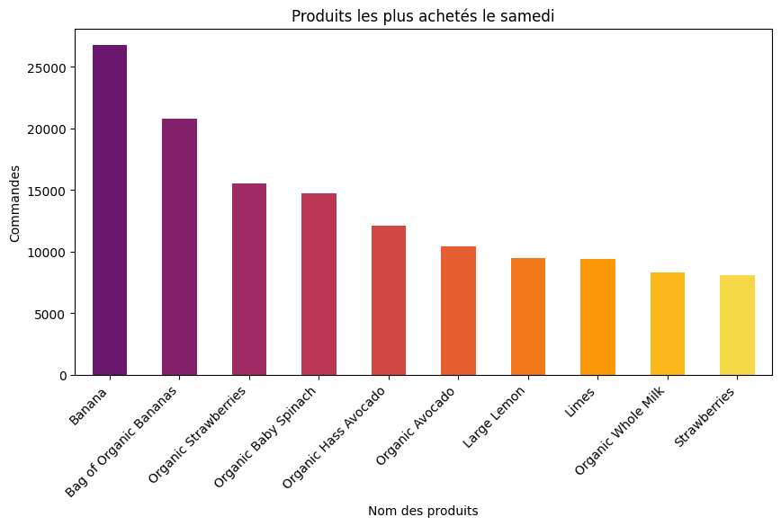
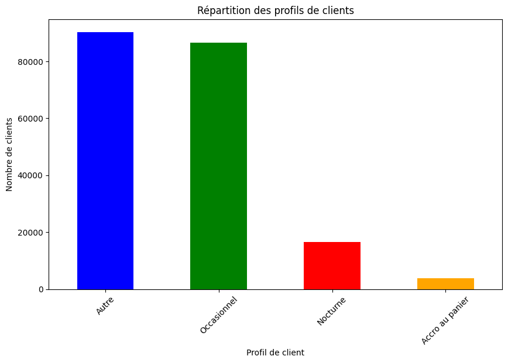
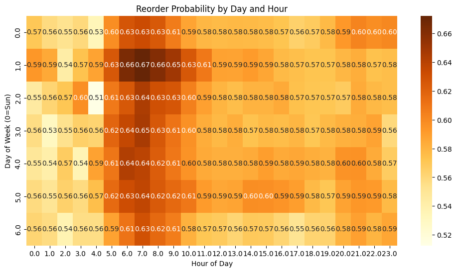

# NextBuy : Assistant de Prédiction de Réachat

NextBuy est un projet de Data Science réalisé en équipe à Epitech Lille. Il vise à analyser les comportements d'achat et à prédire la probabilité qu'un utilisateur commande à nouveau un produit spécifique lors de sa prochaine visite.

Le projet combine des analyses exploratoires approfondies réalisées par plusieurs analystes et un outil de prédiction interactif propulsé par Streamlit.


*Le dashboard Streamlit : on choisit un produit et un contexte de commande, le modèle donne la probabilité de réachat et le meilleur moment de la journée pour proposer le produit.*

## Table des Matières
- Aperçu du Projet
- Quelques Analyses
- Structure du Dépôt
- Installation et Configuration
- Utilisation

## Aperçu du Projet
L'objectif est de répondre à des problématiques métier telles que :

* Analyse temporelle : Identifier quand les clients passent commande (pics horaires et journaliers).
* Segmentation client : Distinguer les profils d'acheteurs (nocturnes, occasionnels, etc.).
* Prédiction : Anticiper le réachat d'un produit selon l'heure, le jour et le délai depuis la dernière commande.

## Quelques Analyses

Les données couvrent 1,4 million de commandes passées par environ 200 000 clients.

<p align="center">
  
  
</p>
<p align="center">
  
  
</p>

* Les commandes se concentrent entre 9h et 16h, avec très peu d'activité la nuit.
* Les fruits et légumes frais (bananes, fraises, épinards, avocats) dominent les achats du samedi.
* Plus de 40 % des clients sont des acheteurs occasionnels ; les acheteurs nocturnes et les « accros au panier » restent minoritaires.
* La probabilité de réachat culmine en début de matinée (6h-9h), avec un pic le lundi vers 7h.

## Structure du Dépôt
* nextbuy_dashboard.py : L'application interactive Streamlit.
* notebook-marius.ipynb : Analyse des pics de commande, produits du samedi et entraînement du modèle (Random Forest).
* notebook-antoine.ipynb : Étude des profils clients, analyse du premier article ajouté au panier, taux de réachat par produit et modèle de régression logistique.
* notebook-oles.ipynb : Analyse comparative (nourriture animaux) et corrélation entre délai de commande et réachat.
* datasets/ : Dossier contenant les fichiers CSV (aisles, departments, order_products, orders, products). Non versionné.
* model.joblib : Le modèle de Machine Learning entraîné. Non versionné (voir ci-dessous).
* encoders.joblib & model_columns.joblib : Fichiers de prétraitement pour le dashboard. Non versionnés.
* images/ : Captures du dashboard et graphiques issus des notebooks, utilisés dans ce README.

## Installation et Configuration

1. Cloner le projet :
   ```bash
   git clone https://github.com/klasken/nextbuy.git
   cd nextbuy
   ```

2. Installer les bibliothèques requises :
   ```bash
   pip install -r requirements.txt
   ```

3. Données : Placez les fichiers CSV d'Instacart dans un dossier nommé datasets à la racine du projet.

4. Modèles : Les fichiers `.joblib` ne sont pas versionnés (le modèle Random Forest pèse environ 240 Mo, au-delà de la limite de GitHub). Exécutez `notebook-marius.ipynb` puis `notebook-antoine.ipynb` pour les générer.

## Utilisation

Pour lancer l'interface de prédiction interactive :
```bash
streamlit run nextbuy_dashboard.py
```
